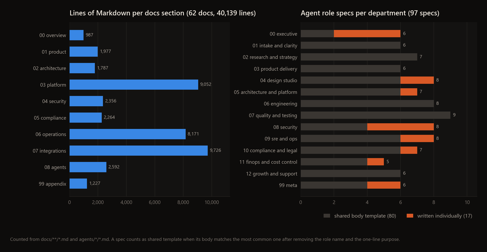
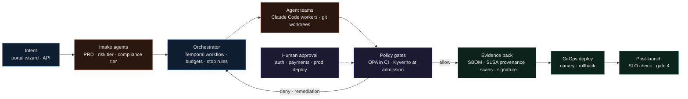

<div align="center">

# Itqahn

**A written design for an agent platform that runs a software company: 62 docs, 97 agent role specs, OPA and Kyverno policies, templates and a few Python checks.**




</div>

Itqahn is my design for a platform where AI agents take a product request through requirements, architecture, build, test and release, with every step checked by policy and recorded as evidence. This repository is the design and the specification. There is no running platform: no orchestrator, no portal, no deployed agents. What exists is the documentation, the agent role specs, the policies (most of which don't compile yet, results below), document templates and five small Python scripts.

---

## What's in here

```text
docs/              62 design docs in 10 sections, 40,139 lines of Markdown
  00-overview/       index, principles, glossary
  01-product/        vision, build types, the four phase gates, requirements schema, ADR policy
  02-architecture/   control plane and data plane, Temporal workflows, memory, tenancy, data classes
  03-platform/       portal, Backstage, CI/CD and GitOps, design system rules, asset pipeline
  04-security/       SPIFFE identity, Vault, SSDF, ASVS, prompt injection, red team
  05-compliance/     compliance tiers, evidence pack, SLSA provenance, SBOM and VEX
  06-operations/     SRE, incidents, runbooks, token budgets, Claude Code operating model
  07-integrations/   Git, webhooks, 11 MCP docs (8 server specs, index, security model, allowlists)
  08-agents/         agent contract, permissions, quality bar, catalog
  99-appendix/       decision log, template index, reference links
agents/            97 role specs in 14 department folders, plus contract, permissions, triggers
policies/          10 Rego policies, 3 Kyverno policies, 8 YAML security and compliance baselines
templates/         53 files: PRD, ADR, evidence pack schema, runbooks, GitHub issue forms, Backstage scaffolders
tools/             5 Python scripts, 2 Rego test files (14 tests), MkDocs site config
legal/             9 policy templates for a hypothetical company
scripts/           make_figures.py (builds the figure above from the repo)
```

Each agent spec is a Markdown file with YAML front matter (department, risk level, triggers, allowed tools, output types) followed by purpose, inputs, outputs, constraints, escalation rules, success metrics and a system prompt. 81 specs are rated medium risk, 7 high and 9 critical. Seventeen specs were written individually, among them the CEO orchestrator, CISO, policy author, prompt injection sentry, token budget enforcer and model router. The other 80 share one body template and differ only in name, a one-line purpose and their front matter.

`legal/` holds terms of service, a privacy policy, a data processing addendum, an acceptable use policy, three disclosure policies, a license policy and a responsible model use policy. They are templates written for a hypothetical company that would run Itqahn as a service. They are not the policies of a real company and they are not legal advice.

## How it's meant to work



A request comes in through the portal and the intake agents turn it into a PRD with a risk tier and a compliance tier. A Temporal workflow then runs the work in stages (intake, architecture, build, test, policy, evidence, deploy, post-launch), and every workflow carries a token budget, a cloud budget, a retry cap and stop conditions. The agents are specified to run as Claude Code sessions, 5 in parallel by default, each in its own git worktree and branch. Each agent gets a short-lived SPIFFE identity, reads secrets from Vault and reaches outside tools only through MCP servers with a per-role allowlist.

Before a merge, release or deploy, an OPA policy decides whether the action is allowed, and Kyverno checks again at Kubernetes admission. A denial pauses the workflow and opens a remediation task. Auth changes, destructive migrations, payment flows, production deploys and policy exceptions also wait for a human approval signal. Nothing ships without an evidence pack: SBOM, SLSA provenance, scan and test results and approvals, signed and kept in write-once storage. The four phase gates (Concept Lock, Experience Lock, Release Candidate, Post-Launch after 7 days) are in [docs/01-product/lifecycle-phase-gates.md](docs/01-product/lifecycle-phase-gates.md) and the component view is in [docs/02-architecture/reference-architecture.md](docs/02-architecture/reference-architecture.md).

## Policies

| Policy (`policies/opa/`) | Package | What it checks | Compiles |
|---|---|---|---|
| `deploy/evidence_required.rego` | `itqahn.deploy` | a deploy request has an evidence pack ID and signature hash | no |
| `mcp/allowlist.rego` | `itqahn.mcp` | an agent role may call an MCP capability (3 roles defined inline) | no |
| `supply-chain/sbom_required.rego` | `itqahn.supplychain` | a release candidate has an SBOM | no |
| `supply-chain/provenance_required.rego` | `itqahn.supplychain` | a release candidate has build provenance | no |
| `security/no_secrets.rego` | `itqahn.security` | a merge has no secret scanner findings | alone only |
| `security/high_risk_approvals.rego` | `itqahn.security` | auth, destructive migration or payment changes have a human approval | alone only |
| `ui/design_jail.rego` | `itqahn.ui` | a merge that touches UI has zero design-system violations | yes |
| `finops/budget_caps.rego` | `itqahn.finops` | a workflow can't continue with no token budget left | yes |
| `github/merge_requirements.rego` | `github.merge` | CI green, approvals, no conflicts, branch up to date, evidence pack for tiers T3 and T4, security review for risky changes, CAB approval for T4 | yes |
| `operator/audit_required.rego` | `operator.audit` | an agent run has a run ID, tenant, workflow ID, audit log and evidence pack config, and the kill switch is off | yes |

"Compiles" means `opa check --v0-compatible` on OPA 1.21.3. The three Kyverno policies enforce no privileged containers, resource requests and limits on every container, and an `itqahn.io/ttl-hours` label on ephemeral namespaces. The YAML files in `policies/security/` and `policies/compliance/` are baselines and control mappings (SOC 2 and others); nothing in this repo reads them.

I ran OPA 1.21.3, the official Windows binary, against the repo:

```bash
opa test policies/ -v
# 121 errors occurred during loading (113 Rego parse errors, 8 YAML data files), 0 tests run

opa check --v0-compatible policies/opa
# 5 errors: conflicting rules and multiple default rules in 4 packages

opa test --v0-compatible policies/opa tools/policy-tests/opa -v
# stops on the same 5 compile errors, 0 tests run

opa test --v0-compatible tools/policy-tests/opa -v
# PASS: 9/14  FAIL: 5/14
```

The policies are written in pre-1.0 Rego (rules without `if`, partial sets without `contains`), so OPA 1.x rejects every file unless it runs with `--v0-compatible`. `opa test policies/` also loads the YAML under `policies/` as data: 7 files collide with each other and `policies/security/api-security.yaml` has a syntax error at line 89. In v0 mode four files still fail, because each declares `default reasons := [...]` on a rule that is also a partial set. Loaded together, `no_secrets` and `high_risk_approvals` both declare `default allow` in the same package, and the two supply-chain files do the same.

The 14 tests in `tools/policy-tests/opa/` import `data.deploy` and `data.mcp`, but the policies live in `itqahn.deploy` and `itqahn.mcp` and expect a different input shape. All 9 passing tests are `not allow` assertions, which pass because the rule is undefined. All 5 tests that expect `allow` fail. The other 8 policies have no tests.

I also ran the six policies that compile through `opa eval` with hand-written inputs and with `templates/governance/POLICY-INPUT.json`. `design_jail`, `no_secrets`, `high_risk_approvals` and `budget_caps` set `default allow := true`, so `allow` came back true even for inputs with 3 design violations, a secret finding, an unapproved auth change or a zero token budget. Their verdict is only in `deny_reason`. `merge_requirements` returned `allow_merge: false` with 6 deny messages for a failing PR and `true` for a clean one, but for a T4 PR touching auth with no security review it returned `allow_merge: true` while `deny` listed the missing security review and CAB approval. `audit_required` returned `allow_run: true` for a complete run record.

## Tools

| Script | What it does | Result on my test inputs |
|---|---|---|
| `tools/validators/design_jail_validator.py --root DIR` | flags CSS files outside `design-system/` or `styles/`, and hex colours, `rgb()` and px values in TS, JS and CSS | 4 violations in a 4-file fixture, exit 1; passes on this repo, which has no app code |
| `tools/validators/evidence_pack_validator.py --manifest FILE` | validates a manifest against `templates/compliance/evidence-pack-manifest.schema.json` and checks that referenced artifacts exist | valid manifest passed; an unknown tier name and a missing test file each failed with exit 1 |
| `tools/validators/sbom_validator.py --sbom FILE` | checks that a JSON file looks like SPDX or CycloneDX | CycloneDX passed, other JSON failed |
| `tools/drift-checker/drift_scoring.py` | placeholder drift score from file and line counts | 12 files and 640 lines scored 0.40 |
| `tools/drift/drift_scoring_stub.py` | older version of the same placeholder | 0.35 for the same diff |

The docs also build into a Material for MkDocs site. `mkdocs build --strict` produced 62 pages with no warnings.

```bash
python -m venv .venv
source .venv/bin/activate        # Windows: .venv\Scripts\activate
pip install -r requirements.txt -r tools/docsite-build/requirements.txt
mkdocs build --strict -f tools/docsite-build/mkdocs.yml
python scripts/make_figures.py
```

## Status and limitations

- There is no implementation of the platform. Temporal, Backstage, SPIRE, Vault, the portal and the agent runtime appear only in the docs.
- 4 of the 10 Rego policies don't compile, 2 more conflict when loaded together, and none of the 14 policy tests checks a real policy. Four policies return `allow: true` regardless of input.
- `merge_requirements.rego` lists a missing security review and CAB approval as deny reasons but still sets `allow_merge` to true.
- Docs and READMEs in the repo point to 34 distinct Rego files under `policies/opa/`; 26 of them don't exist. The Kyverno tests in `tools/policy-tests/README.md` don't exist either, and I didn't run the Kyverno policies against a cluster or the Kyverno CLI.
- Drift scoring is a placeholder. It reads only the intent file's `id` and scores the diff by size.
- `evidence_pack_validator.py` hashes the manifest including its own `signature_hash` field, so any non-empty signature fails the check.
- The two evidence pack schemas disagree on tier names (`tier0` to `tier2` in `templates/compliance/`, `baseline`, `sensitive` and `regulated` in `templates/evidence/`), and `merge_requirements.rego` uses `T1` to `T4`.
- `docs/00-overview/index.md` says 102 agent roles; there are 97 spec files. 10 of the 62 docs aren't in the MkDocs nav.
- Domains and email addresses in the docs (`itqahn.io` and others) are placeholders. Nothing is deployed there.

## License

MIT, see [LICENSE](LICENSE).
